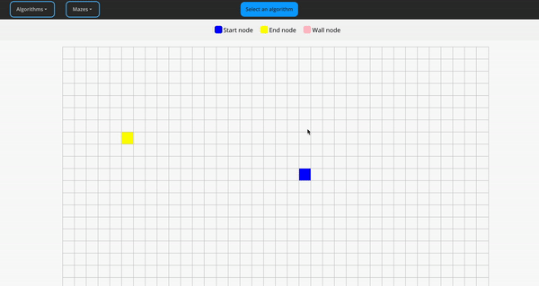

# Pathfinding visualizer

Interactive grid that animates A\* and Dijkstra searches, built with React and TypeScript. [Live demo](https://df-pathfinding.netlify.app/).

### Preview

<a href="https://df-pathfinding.netlify.app/" target="_blank"></a>

###### Algorithms

- [x] A\* Search
- [x] Dijkstra's Algorithm
- [x] Maze generation (recursive division)

###### TO DO

- [ ] Implement Greedy best-first Search algorithm
- [ ] Implement Breadth-first Search algorithm

#### Usage

```sh
  git clone https://github.com/dfoltynski/pathfinding-visualiser.git
  cd pathfinding-visualiser
  npm install
  npm start
```

or just visit https://df-pathfinding.netlify.app/
